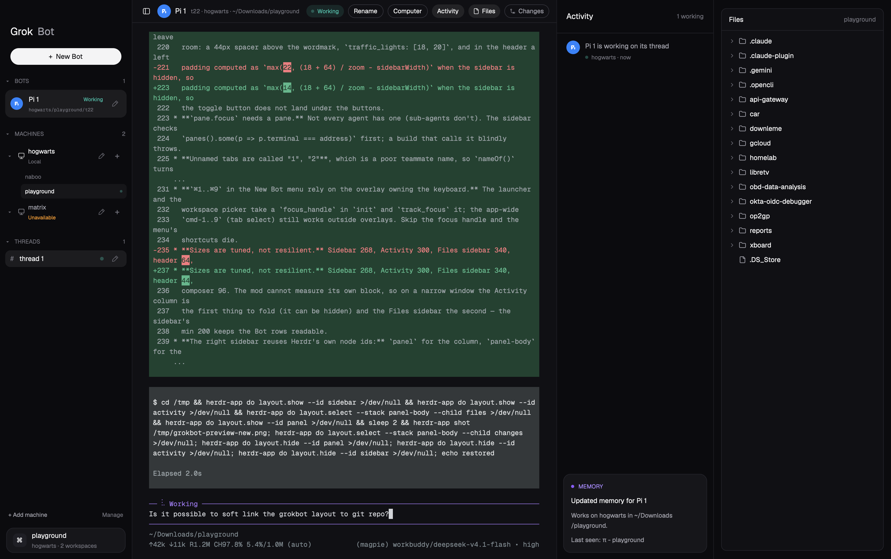

# Herdr app

My layouts and mods for [Herdr](https://herdr.dev), the desktop app for terminals and coding
agents. Herdr redraws itself from the files in `~/.config/herdr-app` while it runs, so everything
here is source for that home: a **layout** is one whole window, a **mod** is a panel that goes into
one. Each folder carries a `RECIPE.md` (the brief another agent could rebuild it from) and a
`preview.png` of the real thing.

| Kind | Folder | What it is |
|---|---|---|
| Layout | [`layouts/`](layouts/) | one folder per window, each a complete `~/.config/herdr-app` you can copy in |
| Mod | [`mods/`](mods/) | one folder per panel, usable in any layout |

## Layouts

| Layout | What it is | Files |
|---|---|---|
| **Grok Bot** | Your coding agents as teammates you message: a buddy list of Bots, the focused Bot's terminal as a chat thread, an Activity feed, and Herdr's Files/Changes browser in a right sidebar. | [`layouts/grokbot/`](layouts/grokbot/) · [preview](layouts/grokbot/preview.png) · [recipe](layouts/grokbot/RECIPE.md) |



## Mods

None yet — see [`mods/`](mods/README.md) for the shape one takes. The layouts here bring their own
panels inside their own folder (`layouts/grokbot/mods/grokbot/`), because those are written for
that one window. A mod in `mods/` is meant to be dropped into any layout, including Herdr's.

## Use one

Herdr redraws itself from `~/.config/herdr-app`, so installing is copying files. Let your agent do
it — it should read every file first:

> Add the Grok Bot layout from https://github.com/xdays/herdr-app to my Herdr.

By hand, for a layout:

```sh
git clone https://github.com/xdays/herdr-app
cd herdr-app
cp layouts/grokbot/layouts/grokbot.json layouts/grokbot/layouts/grokbot.svg ~/.config/herdr-app/layouts/
cp -R layouts/grokbot/mods/grokbot ~/.config/herdr-app/mods/
```

Then switch to it with `cmd-shift-l` (or `herdr-app do layout.switch --name grokbot`). Nothing is
overwritten as long as those names are free — rename the file, the `mod` references and the
`mods/<name>/` asset paths together if they aren't. Leave `RECIPE.md` and `preview.png` out of
`~/.config/herdr-app`; they are for reading, not for the app. Your own layout stays as it was, and
deleting the files removes this one. The Files and Changes sidebar needs nothing extra: those
panels ship with Herdr.

For a mod, the same with `cp -R mods/<mod>/mods/<mod> ~/.config/herdr-app/mods/`; either its
`mod.json` docks it on first sight or a layout names it.

**Discard the layout if it goes wrong:** `ctrl-alt-shift-escape` always works — it sets the shown
layout and `keys.json` aside and returns to the default layout.

## Keeping it live (how I run it)

Instead of copying, I soft-link these files into the Herdr home, so a save in the app or in this
repo is the same edit and Herdr reloads it in place within a second or two:

```sh
ln -sfn ~/Workspace/xdays/herdr-app/layouts/grokbot/layouts/grokbot.json ~/.config/herdr-app/layouts/grokbot.json
ln -sfn ~/Workspace/xdays/herdr-app/layouts/grokbot/layouts/grokbot.svg  ~/.config/herdr-app/layouts/grokbot.svg
ln -sfn ~/Workspace/xdays/herdr-app/layouts/grokbot/mods/grokbot         ~/.config/herdr-app/mods/grokbot
```

Herdr follows those links for reading, for hot reload and for the files it writes itself; only
`herdr-app check` needs the real folder, and it works through a link too. Two things to know: the
link points at one checkout, so the branch that checkout is on is the one on screen, and a link
whose target is gone leaves Herdr without that layout or mod — delete the link with the file.

## What each package holds

Every folder under `layouts/` and `mods/` is one **package**: a copyable miniature of
`~/.config/herdr-app`.

```
layouts/<layout>/              a whole window
  layouts/<layout>.json        the window: blocks, theme, fonts, sizes
  layouts/<layout>.svg         the picture Settings shows for it (optional)
  mods/<mod>/                  the panels it draws, if it has any
  RECIPE.md                    the brief: what you see, how it behaves, how it is built
  preview.png                  a screenshot of the real thing

mods/<mod>/                    a panel any layout can use
  mods/<mod>/                  main.js, mod.json, its icons and fonts
  RECIPE.md
  preview.png
  keys.json                    the keys it expects (optional)
```

## Sharing one

A layout package needs a public repo with the topic `herdr-layout` (or `herdr-mod` for a panel);
Herdr lists it at [herdr.dev/layouts](https://herdr.dev/layouts) within the hour. This repo holds
both kinds, one folder each.

## Notes

These are third-party layouts and mods, not reviewed by Herdr. They run as trusted code, like any
mod: they can run programs, read files and reach the network. Read `RECIPE.md` and the sources
before you install one.
